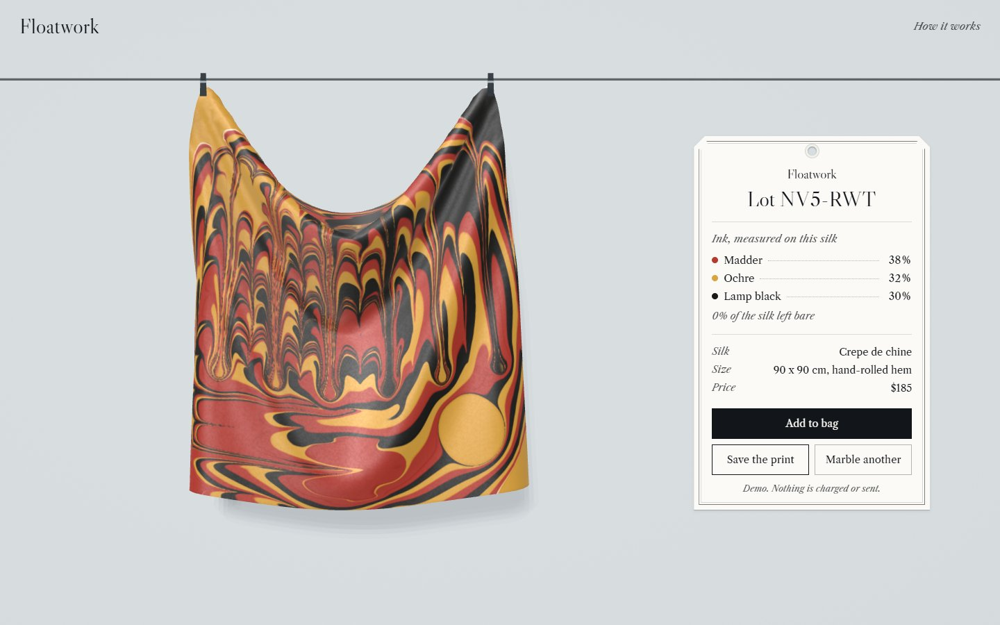
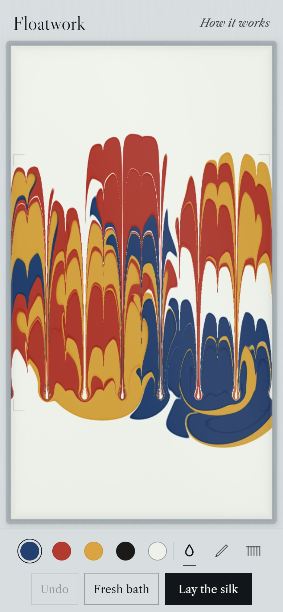

# Floatwork

Marble your own silk scarf on a live bath of floating ink.

**[Try it](https://michaelshadpour.com/try/floatwork)** and read [the write-up](https://michaelshadpour.com/work/floatwork).





## What it is

Floatwork is a fictional silk marbling studio where every scarf is marbled by its buyer. You float inks on a bath, pull them into a pattern with a stylus or a comb, and lay the silk. The scarf lifts out of the bath and hangs as real-time cloth carrying exactly your pattern, with a swing tag that measures its ink and gives it a lot number.

What to try:

- Tap the bath to float ink, and hold for a bigger drop. There are four inks (indigo, madder, ochre and lamp black) and a clear drop that pushes ink aside without adding color.
- Drag through the ink to pull it, or pick the stylus or the comb first.
- Press **Lay the silk**. The silk takes the print and is lifted onto a line.
- Pull the hanging scarf with a finger or the mouse.
- On the swing tag, **Save the print** downloads the pattern as a 2048 x 2048 PNG and **Marble another** starts a fresh bath. **Add to bag** only shows a notice: this is a demo, and nothing is charged or sent.

Below the bath, the page explains how marbling works, where the four inks come from, and how to care for silk.

Adding `?attract=1` to the address starts a self-running demo mode. The bath marbles a scarf by itself in a loop, and hands over on the first touch, click, key press or turn of the mouse wheel.

## How it works

- **The ink never turns to soup.** The ink texture holds pigment concentrations (about 954 x 1783 texels on a phone) and is resampled only when something is baked. Between bakes, all motion lives in a smooth displacement map advected by a stable-fluids velocity field (half-float, Jacobi pressure projection). A spreading drop is drawn as an exact area-preserving map (a point at distance d moves to sqrt(d^2 + A)) until it finishes, and is then baked in one Catmull-Rom resample, clamped so edges never ring. So drops push older ink outward instead of painting over it, and veins stay sharp after dozens of operations.
- **Real marbling math for the tools.** Stylus and comb strokes apply the tine-line displacement from mathematical marbling (a point at distance d from a tine moves by lambda / (d + lambda) of the stroke) to the map every frame, which is what gives the classic flame, chevron and nonpareil shapes. The same strokes push the water, so the bath keeps drifting for a moment after the finger lifts.
- **Color is subtractive, as with real pigment.** Each pigment has its own channel. Color is white times exp(-sum of concentration x absorption), computed in linear light, with absorption solved so a drop on silk lands on the brand swatches (indigo `#24406e`, madder `#b23a2e`, ochre `#d9a441`, lamp black `#1b1a19`). Madder over ochre goes orange, indigo over ochre goes olive, and everything piled up goes brown-black.
- **The scarf lifts out of the bath.** The cloth is a Verlet grid (40 x 40 on desktop, 28 x 28 on phones) with structural, shear and bending constraints, small substeps, long-range attachments to the two pins (so silk never stretches like rubber), and an aerodynamic drag term along each normal, which is what makes it float and ripple like silk. It starts flat on the bath, exactly over the printed square, and the camera travels in one continuous move from overhead to a front view while the corners are lifted to the line. Pointer grabbing uses a ray against a plane facing the camera.
- **The tag is measured, not made up.** The printed square is read back at 64 x 64. The ink percentages are channel sums (rounded with the largest remainder method so they total 100), the bare share counts cells without ink, and the lot number is an FNV-1a hash of the quantized read-back written with digits and consonants only. So the same pattern gives the same lot (an end-to-end test checks this) and a lot can never spell a word. The 2048 x 2048 PNG is rendered from the same concentrations with bicubic sampling.
- **Without WebGL2 there is still a print.** A browser that cannot run the bath gets a marbled square computed on the CPU with the same drop and tine maps.

### Measured during development

These figures were measured while the project was being built. Nothing in the tests checks them.

- First load: about 110 KB gzipped (HTML 2.9 KB, CSS 3.9 KB, JS 24.2 KB, three woff2 fonts 77 KB).
- Frame times at 390 x 844, device pixel ratio 3, with 4x CPU throttling (`npm run perf`, headless Chromium on a desktop GPU through ANGLE):
  - Bath while a finger keeps stirring: median frame interval 16.7 ms (60 fps), main-thread work 0.90 ms median, 1.10 ms p95.
  - Cloth hanging in the wind: 16.6 ms (60 fps), main thread 3.3 ms median, 4.1 ms p95.
  - Cloth while being pulled: 16.5 ms (60 fps), main thread 3.3 ms median, 4.1 ms p95.
- The throttling only slows the CPU. GPU cost on a real phone was not measured.

### Known limits

- GPU frame time on a real mid-range phone has not been measured. The frame times above come from headless Chromium using a desktop GPU with the CPU throttled. The simulation scales its texture budget down on touch devices and falls back to 8-bit targets where float render targets are missing, but it has not been tried on a low-end Android phone.
- On phones, the printed square is simulated at a lower resolution than the 2048 x 2048 PNG, so the PNG is upsampled with bicubic filtering. Edges stay clean but are not as fine as a native 2048 simulation.
- A drop that is still spreading is drawn on top of the bath, so a stroke made in the same split second moves the ink around it but not the drop itself until it settles (about 0.7 s). A drop held down with one finger while another finger draws stays round.
- Undo history is cleared when the window is resized or rotated, though the ink itself is kept.
- The cloth has no self-collision, so a hard pull can pass a fold through itself.
- Two fingers make two independent strokes, but this was only tried with emulated input, not on a real multi-touch screen.

## Stack

- Vite 6 and TypeScript (strict), no framework.
- Raw WebGL2 for both the bath simulation and the cloth, with no 3D library. The cloth samples the print texture straight out of the simulation's own GL context, so nothing is copied between contexts.
- Fonts are self-hosted through `@fontsource`. The page loads its own files and makes no other network requests at runtime.
- Vitest for the unit tests and Playwright for the end-to-end tests.

## Run it

```
npm install
npm run dev        # http://localhost:5311
npm test           # unit tests: ink percentages and lot numbers
npm run build      # type check, then build the static site into dist/
npm run preview    # serves the project folder; open http://127.0.0.1:5311/dist/
```

The dev server is pinned to port 5311. If that port is taken it stops with an error instead of picking another one. `npm run preview` and the end-to-end tests use the same port, so stop the dev server before you run them.

End-to-end tests, run at phone size with touch and at desktop size:

```
npx playwright install chromium
npm run test:e2e   # builds first, then runs Playwright against dist/
```

Frame times, which need a build and the Chromium installed above:

```
npm run build
npm run perf       # 390 x 844 with 4x CPU throttling
```

There are 13 unit tests in `tests/` and 5 end-to-end tests in `e2e/`.

The Playwright config and the perf script start Chromium with `--use-angle=d3d11`, which is a Windows (Direct3D 11) setting. On macOS or Linux you may need to change or remove that flag.

Two address parameters exist for demos and tests. `?attract=1` starts the self-running demo mode. `?capture=1` stops the real-time loop, so a test can step the clock frame by frame with `window.__step(ms)`.

## Layout

- `index.html`: the page, with the tool tray, the swing tag and the reading sections.
- `src/main.ts`: input, the four modes (bath, laying, lifting, scarf), the camera, the frame loop and the self-running demo.
- `src/gl/`: the WebGL2 code. `bath.ts` and `bathShaders.ts` are the marbling simulation, `cloth.ts` and `clothRender.ts` are the cloth and its renderer, and `math.ts` and `util.ts` are small helpers.
- `src/recipe.ts`, `src/pigments.ts`, `src/attract.ts`, `src/fallback.ts`: the swing tag numbers, the pigment colors, the scripted patterns for the demo mode, and the CPU print for browsers without WebGL2.
- `tests/`: unit tests for the ink percentages and lot numbers.
- `e2e/`: Playwright tests.
- `scripts/`: `serve.mjs` is the static server behind `npm run preview` and the end-to-end tests. `perf.mjs` and `browser.mjs` measure frame times.
- `docs/`: the screenshots in this README.

## Credits and license

- Fonts: Libre Caslon Display and Libre Caslon Text by Impallari Type, SIL Open Font License 1.1, through `@fontsource/libre-caslon-display` and `@fontsource/libre-caslon-text` (Latin subset only: Display 400, Text 400 and 400 italic).
- There are no photographs or other pictures. The bath, tray rim, zinc bench, ink and silk are shaders, the tool icons and the favicon are SVG, and the fallback print is computed in code.

Concept project. Floatwork is a fictional brand.

Design and build: [Michael Shadpour](https://michaelshadpour.com).

The code is under the MIT license. See [LICENSE](LICENSE).
